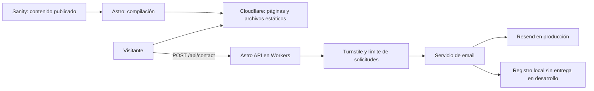

# Sociedad Italiana de Arrecifes

Sitio de la Sociedad Italiana de Socorros Mutuos “Voz de Caprera”. Astro + TypeScript, Tailwind, Sanity Studio y Cloudflare Workers. Se conserva el diseño y las páginas existentes: la web es estática y solo Contacto necesita ejecutar código del servidor.

**Para cargar eventos, fotos o datos institucionales:** [guía en español para personas no técnicas](docs/README.md). Lo que sigue está dirigido a quien configura y mantiene el proyecto.

## Arquitectura



| Momento                         | Código que se ejecuta                                                                                 |
| ------------------------------- | ----------------------------------------------------------------------------------------------------- |
| Compilación                     | Sanity, filtros y orden de eventos, fechas argentinas, páginas Astro, sitemap                         |
| Navegador                       | Menú, validación de comodidad, widget Turnstile y estados del formulario                              |
| Cada solicitud a `/api/contact` | Validación real, control de origen, límite de solicitudes, verificación de Turnstile y envío de email |

La configuración usa el adaptador oficial `@astrojs/cloudflare`. Aunque establece salida `server`, **todas las páginas públicas y robots declaran `prerender = true`**; el endpoint declara `false`. `run_worker_first: ["/api/*"]` envía la API al Worker y permite servir los archivos estáticos sin ejecutar la aplicación. No hay Express, servidor Node en producción, base de datos, KV, sesiones ni autenticación propia. Sanity Studio se publica por separado en el alojamiento de Sanity como antes; no es otro backend propio.

```text
web/src/
  components/common/    Texto enriquecido
  components/events/    Tarjetas y estados vacíos
  components/forms/     Contacto y formularios de trámites existentes
  layouts/              Presentación compartida
  pages/                Páginas estáticas; api/contact.ts es la entrada HTTP
  lib/sanity/           Cliente, consultas y acceso a datos publicados
  lib/events/           Servicio de agenda, filtros y fechas
  lib/email/            Integración Resend y registro local
  lib/validation/       Esquema Zod de contacto
  lib/security/         Verificación Turnstile
  lib/server/           Configuración y manejo HTTP del contacto
  types/                Tipos compartidos
studio/                 Administrador y esquemas Sanity
scripts/                Verificación de salida estática
```

`lib/content.ts` reúne datos institucionales y eventos para la compilación; conserva los textos de respaldo existentes. Si Sanity está configurado pero falla, el build falla: no reemplaza silenciosamente contenido publicado por datos vacíos. `astro build` también falla si faltan `PUBLIC_SITE_URL` o `PUBLIC_SANITY_PROJECT_ID`, salvo con `ALLOW_MISSING_BUILD_CONFIG=1`, pensado solo para builds que no se despliegan (CI o pruebas locales sin CMS). No se inventan eventos.

## Desarrollo local, sin dominio ni cuenta de email

Requisito: **Node.js 24 LTS** y npm. Las versiones están fijadas en `package-lock.json`.

Desde la raíz del repositorio:

```sh
npm ci
cp web/.env.example web/.env
cp web/.dev.vars.example web/.dev.vars
npm run dev
```

Abrí **http://localhost:4321/contacto/**. Completá Nombre, Email, Asunto, Mensaje y consentimiento. El widget usa las claves oficiales de prueba de Cloudflare. Al enviar, el mensaje se imprime en la terminal o en los registros del servidor de desarrollo y la pantalla dice **“Prueba local… No se envió ningún correo”**. No se necesita Resend ni un dominio. Usá datos ficticios: el registro local incluye el contenido para poder inspeccionarlo.

Astro 7 puede iniciar el servidor en segundo plano. Para ver los mensajes locales o detenerlo:

```sh
npm exec -w web astro -- dev logs
npm exec -w web astro -- dev stop
```

El modo mock solo funciona en `astro dev` y con una URL de loopback (`localhost`, `127.0.0.1` o `::1`). No sirve para publicar una demo que simule entregas. No uses una IP de la red local para probarlo.

```sh
npm run check          # Genera tipos de Workers; revisa Astro y Studio
npm test               # Pruebas sin enviar correos reales
npm run build          # web/dist/client + web/dist/server; sin Sanity: ALLOW_MISSING_BUILD_CONFIG=1 npm run build
npm run verify:build   # Comprueba páginas estáticas y API runtime
npm run preview        # Runtime workerd con el build de producción
npm run dev:studio     # Requiere configurar Sanity
```

`preview` usa las restricciones de producción: las claves dummy y el proveedor mock se rechazan con 503 incluso en localhost. Con una site key de prueba, el build fuera de `dev` no muestra el widget y el formulario queda deshabilitado. Usá `dev` para la prueba local de email. La vista previa permite comprobar que las páginas estáticas funcionan y que el endpoint falla de manera segura sin credenciales.

## Variables de compilación y secretos de ejecución

**Son dos configuraciones diferentes.** Cambiar una variable de compilación requiere recompilar; los secretos del servidor se leen mediante `env` de `cloudflare:workers`, nunca mediante variables `PUBLIC_*`.

| Variable                    | Dónde va                                  | Uso                                                                                  |
| --------------------------- | ----------------------------------------- | ------------------------------------------------------------------------------------ |
| `PUBLIC_SITE_URL`           | `web/.env` / variables de Workers Builds  | URL pública definitiva para metadatos y sitemap; localmente `http://localhost:4321`  |
| `PUBLIC_SANITY_PROJECT_ID`  | Compilación                               | ID público de Sanity; vacío solo en `dev` o con `ALLOW_MISSING_BUILD_CONFIG=1`       |
| `PUBLIC_SANITY_DATASET`     | Compilación                               | `production`                                                                         |
| `PUBLIC_TURNSTILE_SITE_KEY` | Compilación y navegador                   | Clave pública del widget; clave real para despliegues públicos                       |
| `EMAIL_PROVIDER`            | Runtime: `.dev.vars` / `wrangler.jsonc`   | `mock` local; `resend` en producción                                                 |
| `TURNSTILE_SECRET_KEY`      | Runtime: `.dev.vars` / secreto Cloudflare | Verificación del token en el servidor                                                |
| `RESEND_API_KEY`            | Secreto runtime Cloudflare                | Credencial de envío; nunca se publica                                                |
| `EMAIL_FROM`                | Runtime: `vars` en `web/wrangler.jsonc`   | Remitente fijo, por ejemplo `Sociedad Italiana <contacto@dominio-verificado.com.ar>` |
| `EMAIL_TO`                  | Runtime: `vars` en `web/wrangler.jsonc`   | Casilla fija receptora, normalmente `soc.italiana.arrecifes@gmail.com`               |
| `CONTACT_ORIGIN`            | Runtime: `vars` en `web/wrangler.jsonc`   | Origen HTTPS autorizado, sin barra final, por ejemplo la URL `workers.dev`           |
| `CONTACT_RATE_LIMITER`      | Binding en `web/wrangler.jsonc`           | Cinco intentos por minuto y por IP en cada ubicación de Cloudflare                   |

No comitear `.env`, `.dev.vars`, tokens, contraseñas ni URLs de deploy hooks. Las plantillas de ejemplo contienen únicamente valores públicos o claves de prueba oficiales. `worker-configuration.d.ts` se genera automáticamente con `npm run check` y no se versiona.

En producción, si faltan remitente, destinatario, API key, origen, clave Turnstile, clave pública o binding de límite, Contacto devuelve **503**. También rechaza las claves de prueba oficiales y `EMAIL_PROVIDER=mock`. No hay una caída silenciosa a un proveedor simulado.

## Contacto y correo

`POST /api/contact` recibe todos los formularios del sitio. Acepta JSON con `kind` (`contacto`, `alta`, `baja`, `escuela`, `salones`, `deudas`, `panteones` o `ciudadania`), `name`, `email`, `consent: true`, `website: ""`, `turnstileToken` y los campos propios de ese formulario, definidos en `web/src/lib/validation/contact.ts` (por ejemplo `subject` en contacto o `address`, `city` y `postalCode` en alta). Cada formulario tiene un esquema estricto: rechaza campos desconocidos o de otro formulario, incluidos destinatarios enviados por el cliente. Las opciones de los desplegables se validan contra la misma lista que usa el formulario.

- Nombre: 1–100 caracteres; asunto: 1–140; mensaje: 1–5000 (opcional solo en baja). Se aceptan mensajes cortos.
- Email válido, consentimiento obligatorio, token máximo 2048 caracteres.
- Cuerpo máximo 32 KiB, medido al leerlo, sin confiar en `Content-Length`.
- Solo JSON y mismo origen autorizado; no se habilita CORS para sitios externos.
- Turnstile se verifica en servidor, incluyendo hostname y acción `contact` en producción. Tokens vencidos o reutilizados se rechazan.
- Honeypot complementario y rate limit de Workers. Si el limitador o Turnstile no están disponibles, no se envía correo.
- El límite es aproximado y por ubicación de Cloudflare, no una cuota global estricta. No usa una base de datos. El `namespace_id` debe ser único respecto de otros limitadores de la misma cuenta si no se quieren compartir contadores.
- El servicio fija `from` y `to` desde el servidor, y usa el email del visitante como `reply_to`. El asunto es `[<formulario>] <asunto>` en Contacto y `[<formulario>] <nombre>` en los trámites, por ejemplo `[Solicitud de alta] Ana Pérez`.
- Email con texto plano y HTML escapado; no se interpreta HTML del visitante ni se permiten saltos de línea en encabezados.
- Los errores no exponen respuestas del proveedor, credenciales ni contenido. No se registran datos de solicitudes en producción.

Respuestas:

| HTTP                     | Significado                                                          |
| ------------------------ | -------------------------------------------------------------------- |
| 202                      | Resend aceptó el mensaje. No garantiza entrega en bandeja de entrada |
| 200, `status: simulated` | Solo desarrollo local: registrado, no enviado                        |
| 400 / 413 / 415          | Cuerpo inválido / demasiado grande / tipo de contenido incorrecto    |
| 422                      | Error de campos: `error.fields` indica cuáles                        |
| 403                      | Origen o Turnstile inválido                                          |
| 405                      | Método no permitido, con `Allow: POST`                               |
| 429                      | Demasiados intentos, con `Retry-After: 60`                           |
| 502                      | Fallo o falta de confirmación del proveedor de email                 |
| 503                      | Configuración incompleta o protección no disponible                  |

Los errores usan `{ "ok": false, "error": { "code": "…", "message": "…", "fields": {} } }`; `fields` es opcional. Todas las respuestas indican `Cache-Control: no-store`. El formulario mantiene los datos ante errores, evita envíos simultáneos, renueva el desafío y anuncia el estado de forma accesible. Necesita JavaScript; siempre ofrece el correo directo como alternativa.

### Formularios de trámites

Socios, escuela y salones usan el mismo componente (`RequestForm.astro`) y el mismo endpoint que Contacto. El correo indica el trámite y el nombre en el asunto, y lista solo los campos completados. Los trámites no se guardan en Sanity ni se aprueban automáticamente.

Cambiar el correo visible en Sanity actualiza los enlaces "escribinos" del sitio, pero no cambia `EMAIL_TO`, definido en `web/wrangler.jsonc`. `web/src/lib/navigation.ts` define el correo de respaldo visible. La [guía de administración](docs/README.md) explica esta diferencia.

## Sanity: configuración y eventos

1. En [Sanity Manage](https://www.sanity.io/manage), usá el proyecto de la institución y un dataset público `production`.
2. Completá `PUBLIC_SANITY_PROJECT_ID` y `PUBLIC_SANITY_DATASET` en el entorno de compilación web.
3. Copiá `studio/.env.example` a `studio/.env` y completá `SANITY_STUDIO_PROJECT_ID` y `SANITY_STUDIO_DATASET` con los mismos valores.
4. Ejecutá `npm run dev:studio`. Agregá `http://localhost:3333` como origen CORS de Sanity con credenciales si hace falta.
5. Cargá **La institución** y **Eventos**, y publicá los documentos. El sitio lee solo contenido publicado.
6. Publicá el administrador:

```sh
cd studio
npx sanity login
npm run deploy
```

Agregá la URL del Studio a CORS con credenciales e invitá editores desde Sanity Manage. El dataset es público: no cargar datos personales, padrones ni documentos privados.

La agenda se calcula al compilar, con hora `America/Argentina/Buenos_Aires` y formato `es-AR`. Próximos se ordenan del más cercano al más lejano; anteriores, del más reciente al más antiguo. La finalización mantiene un evento en curso entre próximos. Sin finalización, pasa a anteriores después del inicio. Fechas inválidas, ambiguas o intervalos invertidos se excluyen. Los eventos existentes sin estado se consideran programados.

El nuevo campo **Estado → Cancelado** quita el evento de la agenda, conserva su URL estática con un aviso e impide mostrar el enlace de entradas. No borres el documento si querés mantener el aviso para quienes ya recibieron el enlace. Publicá también el Studio actualizado para que los editores vean el campo.

### Recompilación al publicar y actualización diaria

En **Workers Builds**, creá un **Deploy Hook** para el Worker conectado al repositorio y a `main`. La URL es secreta. Si antes se usaba Pages, reemplazá el hook de Pages por el de Workers en ambos lugares siguientes:

- **Sanity Manage → API → Webhooks:** URL del hook, método POST, dataset `production`, eventos create/update/delete; filtro `(_type == "event" || _type == "siteSettings") && !(_id in path("drafts.**"))`.
- **GitHub → Settings → Secrets and variables → Actions:** guardá la URL como `CLOUDFLARE_DEPLOY_HOOK`. El workflow `rebuild.yml` hace un POST diario a las 00:15 de Argentina y también admite ejecución manual.

Sin el secreto, el workflow informa que falta configuración y no publica. Los cambios de fecha no se reflejan hasta la próxima compilación; GitHub puede retrasar tareas o deshabilitarlas en repositorios públicos inactivos. Comprobá publicaciones, cancelaciones, despublicaciones y actualización diaria después de migrar. [Deploy Hooks de Workers](https://developers.cloudflare.com/workers/ci-cd/builds/deploy-hooks/).

## Cloudflare Workers: publicar sin dominio

El adaptador actual usa **Workers**, no el antiguo flujo de **Pages**. No subas solo `web/dist/client`: eso dejaría la API sin servidor. Un único Worker incluye los archivos estáticos y el endpoint; Cloudflare asigna una URL `https://nombre.subdominio.workers.dev`.

### Primera publicación por terminal

Desde la raíz:

```sh
npm ci
npm run build
npm run verify:build
cd web
npx wrangler login
npm run deploy
```

Wrangler usa la configuración generada por Astro después del build. `web/wrangler.jsonc` define el entrypoint oficial, assets, compatibilidad Node y binding del limitador. No hay que crear un servidor aparte. El primer despliegue puede hacerse sin secretos de email: la web funcionará y Contacto responderá 503 hasta completar su configuración; no simulará entregas.

Anotá la URL real asignada y usala en `PUBLIC_SITE_URL`. Recompilá y publicá otra vez para actualizar metadatos. No se afirma que la dirección temporal de ejemplo exista.

### Publicación automática desde GitHub

Conectá el repositorio existente `fedetesone/sociedad-italiana-de-arrecifes` a **Workers Builds**:

| Opción                | Valor                |
| --------------------- | -------------------- |
| Rama de producción    | `main`               |
| Directorio raíz       | Raíz del repositorio |
| Comando de build      | `npm run build`      |
| Comando de despliegue | `npm run deploy`     |
| Node                  | `24`                 |

Agregá las variables **de compilación** `PUBLIC_SITE_URL`, las de Sanity y `PUBLIC_TURNSTILE_SITE_KEY` en la configuración de Builds. Las credenciales de email y Turnstile van en los **secretos del Worker**, no solo en los secretos del proceso de build. No publiques automáticamente ramas de prueba sobre el Worker de producción.

Si existe un proyecto Pages previo, mantenelo hasta verificar Workers. La integración nueva requiere configurar Workers Builds y cambiar los hooks; un push por sí solo no convierte Pages en Workers. Para un dominio ya conectado a Pages, verificá primero la URL temporal y luego trasladá la asociación al Worker.

## Turnstile y activación de Resend

### Turnstile

1. Creá un widget Turnstile en Cloudflare y autorizá el hostname exacto de la URL temporal `workers.dev` (sin protocolo ni ruta).
2. Colocá la **site key real** en `PUBLIC_TURNSTILE_SITE_KEY` y recompilá.
3. Guardá la **secret key real** en el Worker.
4. Configurá `CONTACT_ORIGIN` en `web/wrangler.jsonc` con el origen HTTPS autorizado completo, sin barra final.

Las claves locales de ejemplo son las oficiales: site key `1x00000000000000000000AA` y secret key `1x0000000000000000000000000000000AA`. No se aceptan para la API de producción. [Pruebas oficiales](https://developers.cloudflare.com/turnstile/troubleshooting/testing/).

### Al comprar el futuro dominio `.com.ar`

1. Conectá el dominio al Worker en Cloudflare y verificá HTTPS. Actualizá `PUBLIC_SITE_URL` y `CONTACT_ORIGIN`; agregá el nuevo hostname al widget Turnstile y recompilá.
2. Creá o usá la cuenta institucional en Resend. Agregá el dominio remitente y copiá los registros DNS que indique Resend. No inventes registros ni reemplaces los de recepción de correo existentes.
3. Esperá que Resend indique dominio verificado y creá una API key con permiso de envío.
4. Cargá las dos claves como secretos del Worker, desde `web/` con los comandos siguientes o en el panel con tipo **Secret**. Las variables de tipo Text del panel se borran en cada deploy. No pongas claves en archivos versionados:

```sh
npx wrangler secret put RESEND_API_KEY
npx wrangler secret put TURNSTILE_SECRET_KEY
```

5. En `web/wrangler.jsonc`, cambiá `EMAIL_FROM` por un remitente del dominio verificado, por ejemplo `Sociedad Italiana <contacto@tu-dominio.com.ar>`, y `CONTACT_ORIGIN` por el origen del dominio. `EMAIL_TO` es la casilla institucional. Son valores públicos, no secretos; se publican con un push. Mientras no haya dominio, el sitio usa el modo de prueba de Resend: remitente `onboarding@resend.dev` y entrega solo a la casilla de la cuenta de Resend, que debe coincidir con `EMAIL_TO`.
6. Probá una consulta desde el sitio público. Comprobá el asunto, contenido, destinatario y que Responder vaya al visitante. Revisá los eventos de entrega de Resend y la bandeja/Spam: **202 significa aceptado por Resend, no entregado en Gmail**.
7. Actualizá los enlaces de la guía de administración y probá también un formulario de trámite.

La web puede estar publicada en `workers.dev` antes de comprar el dominio. La entrega normal con remitente institucional requiere verificar un dominio en Resend; mientras tanto, se desarrolla con el registro local, sin afirmar envíos reales.

## Pruebas y límites de verificación

`npm test` cubre orden y filtros de eventos, cancelaciones, intervalos inválidos, límites de fechas argentinos, validación Zod, envío Resend simulado y fallos, verificación Turnstile, origen, métodos, tamaños, rate limit, errores de API y rechazo de mock/claves de prueba en producción. Ninguna prueba unitaria entrega correos.

`npm run verify:build` comprueba archivos públicos prerenderizados, declaraciones estáticas de rutas —incluida la plantilla de eventos—, salida runtime para la API, ausencia de KV y ausencia de referencias a secretos del servidor en JS/HTML públicos. Los eventos reales dependen del dataset publicado; sin Sanity no se generan páginas de eventos ficticios.

La entrega real necesita credenciales y dominio verificado. La publicación en Cloudflare y el funcionamiento de los hooks requieren acceso/configuración de la cuenta; las pruebas locales no los sustituyen.

## Contenido institucional y mantenimiento

Profesor: **Matias Costantini Reschia**. Escuela: **cuatro niveles más Conversación**. Dirección: **España 694, Arrecifes, Buenos Aires**. Teléfono: **2478 610004**. Faltan aranceles, horarios, condiciones de bonificaciones, nómina y mandato de comisión y detalles de salones. Escuela y servicios siguen siendo páginas estáticas editadas en código. La fotografía de Italia es ilustrativa; reemplazarla por fotografías propias desde Sanity.

Fuentes: [historia](docs/historia-fuentes.md) y [servicios](docs/servicios-fuentes.md). El proyecto conserva los overrides de dependencias indirectas de Sanity; revisarlos al actualizar paquetes. `npm run format` aplica Prettier.

La sección de referencia consular de `/contacto/` se mantiene en `web/src/components/contact/ConsulateInfo.astro`, con datos y enlaces oficiales del Consulado de Rosario. Es contenido estático independiente de los contactos de la Sociedad en Sanity; no cambia el destino ni el flujo del formulario. Las fuentes y la fecha de consulta figuran en `docs/servicios-fuentes.md`.

Las secciones de INAES y Municipalidad de Arrecifes se mantienen en `web/src/components/contact/PublicInstitutions.astro`, con el mismo criterio de contenido estático y fuentes oficiales documentadas.

Referencias técnicas: [adaptador oficial Astro](https://docs.astro.build/en/guides/integrations-guide/cloudflare/), [Astro en Workers](https://developers.cloudflare.com/workers/framework-guides/web-apps/astro/), [rate limiting](https://developers.cloudflare.com/workers/runtime-apis/bindings/rate-limit/), [verificación Turnstile](https://developers.cloudflare.com/turnstile/get-started/server-side-validation/) y [API Resend](https://resend.com/docs/api-reference/emails/send-email).
